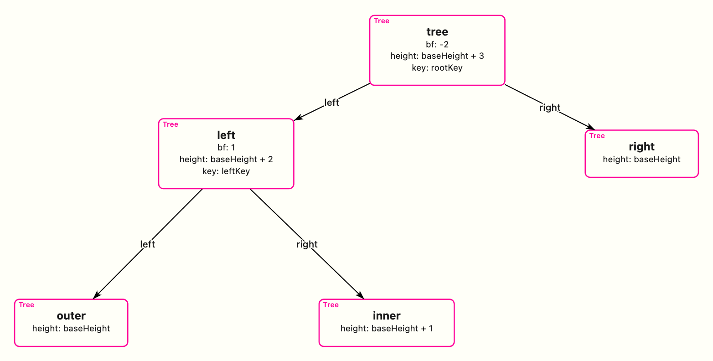
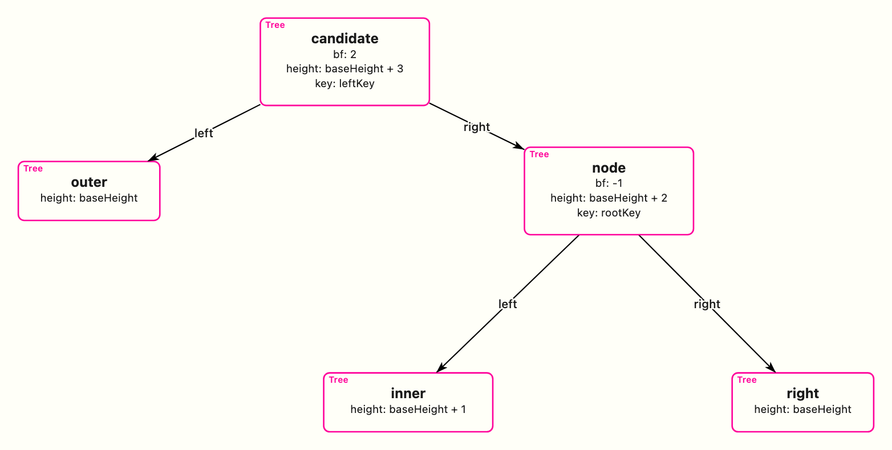
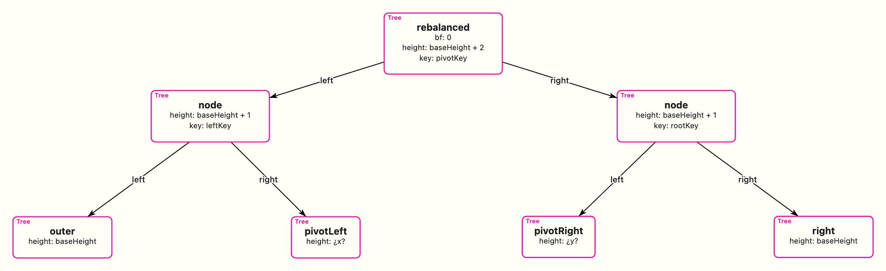

# Can the left child replace the root?

An insertion returns to a root whose left subtree is two levels taller than its right. A right rotation would promote the left child. Before making that change, follow one subtree through it. The left child’s right subtree, called `inner`, would become the old root’s left child. **Is there room for its height there?**

## Inspect the tree already in scope

In `rebalance`, stop at the line that computes `leftFactor`. The inspected expression is just `left`.

```lean
let leftFactor := bf (spytial left observing [height] with [.., attribute height])
```

The surrounding `match leftShape : left with` gives the node branch an equation connecting `left` to its fields. The picture shows a root named `left`, its key `leftKey`, and its children `outer` and `inner`. Their heights are unknown here, so the parent’s observed height is one plus their maximum. The next inspection of `tree` shows where that same child sits under the original root. [Inspect the left child](AVL.lean#L124) · [Inspect the whole input](AVL.lean#L126)

Now open `rebalance_after_insert`. The proof binds `tree` once, while `left` and `right` are still opaque. The inspections on either side of the branch both say `spytial tree observing [height, bf]`. The branch hypotheses supply enough information to make a prediction. [Outer grandchild taller](AVL.lean#L193) · [Inner grandchild taller](AVL.lean#L211)



`baseHeight` is the height of the untouched right subtree. Read the two edges out of `left`. Each named box at their ends stands for a whole subtree whose interior is still unknown. In the concrete examples, an empty child slot has no edge.

| Before the rotation | Outer grandchild taller | Inner grandchild taller (pictured) |
| --- | --- | --- |
| Height of `outer` | `baseHeight + 1` | `baseHeight` |
| Height of `inner` | `baseHeight` | `baseHeight + 1` |
| Balance factor at the root | −2 | −2 |
| Balance factor at its left child | −1 | +1 |

The factor is right height minus left height. The proof assumes both children of the root are balanced, so the heights under `left` can differ by at most one. The hypothesis `leans : bf left ≠ 0` rules out a tie. **In which column can a single right rotation finish the repair? In the other column, predict the balance factor at the promoted child, including its sign.**

## Move the inner subtree

In the first column, the rotation puts `inner` beside `right` under the old root. Both have height `baseHeight`. Their parent therefore has height `baseHeight + 1`, exactly matching `outer` across the new root. Its balance factor is **0**. This is the return value in that branch. [Inspect the single rotation](AVL.lean#L197)



In the second column, follow the same pointer. This time `inner` has height `baseHeight + 1`, so the rebuilt node at `rootKey` has height `baseHeight + 2`. Across from it sits `outer`, still at `baseHeight`. The diagram reports **+2** at the candidate root. That factor belongs to a newly built node. Lean derives it from the input heights. The separate theorem `singleRotation_fails` checks this proposed move and proves its result violates `Balanced` for every input with these heights. [Inspect the rejected candidate](AVL.lean#L258)

## Which child moves where?

Back in the actual repair, `inner` has positive height. Opening it must expose a node. Its key is `pivotKey`, and its two children are `pivotLeft` and `pivotRight`. The proof inspects `tree` again at this point. **If the pivot becomes the new root, which of those children belongs on the right of the node with key `leftKey`?** [Inspect the exposed pivot](AVL.lean#L229)



Read the keys in order. `pivotLeft` sits between `leftKey` and `pivotKey`, so it goes to the right of `leftKey`. Likewise `pivotRight` goes to the left of `rootKey`. The implementation makes these connections by rotating the left child left, then the root right. [Inspect the return value](AVL.lean#L237)

The two pivot subtrees still have symbolic heights. Their maximum is `baseHeight`, and balance of their old parent puts them within a level of one another. Each now has a partner of height `baseHeight`, so both rebuilt children are balanced and have height `baseHeight + 1`. The proof finishes with both interiors unopened. [See the local repair proof](AVL.lean#L248)

To replay the inspections, select a highlighted expression or the theorem name in the Lean infoview. To check the local repair theorem from the repository root, run `lake env lean Demos/AVL.lean`.
