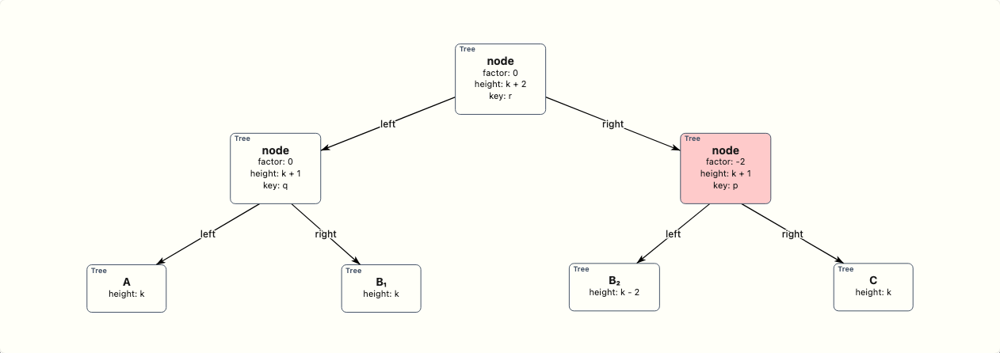

# Can a double rotation leave a height gap of two?

DCIC ends *Sets from Trees* with a puzzle. In the left-right case, one of the pivot’s children
has height `k`. What if the other has height `k − 2`? Follow that short subtree through the
rotation and it ends up next to a subtree of height `k`. Has AVL insertion just returned an
unbalanced tree? [DCIC, §18.2.3.3](https://dcic-world.org/2025-08-27/sets-from-trees.html)

## Try one insertion two ways

Open the Lean demo and place the cursor on the first `#spytial`. An ordinary BST insertion
has just added 4. Read the path back up through 5, 6, 3, and 8. Both 6 and 8 have a balance
factor of +2. **Which one does the recursive call reach first?** [Inspect the tree](DCICSetsFromTrees.lean#L66)

| What you do next | What the diagram shows |
| --- | --- |
| Apply the double rotation at 8 immediately | 6 becomes the root with factor 0. Its right child, 8, has factor −2. |
| Run AVL insertion from the original tree | A right rotation at 6 promotes 5, with children 4 and 6. This subtree regains its old height. The root stays 8. |

## Follow the short subtree

The same failed repair appears in the proof with every key and subtree left symbolic. Before
rotating, `B₂` is the right child of the pivot `r`. Afterwards it is the left child of `p`.
Read the heights on either side of `p` in the diagram. [Compare both proof inspections](DCICSetsFromTrees.lean#L95)

At the point where AVL insertion would actually rotate at `p`, its left child has already
returned a balanced tree. That includes the pivot `r`. Its taller child has height `k`, so
the other must be within one level of `k`. This rules out the two-level gap on either side.
Pairing each of `B₁` and `B₂` with an outer subtree of height `k` now gives **two balanced
children of height `k + 1`**. Lean proves that the implementation takes this branch and that
the in-order key sequence survives it. [Inspect the bottom-up repair](DCICSetsFromTrees.lean#L129)

Check the demo from the repository root with `lake build Demos.DCICSetsFromTrees`.
