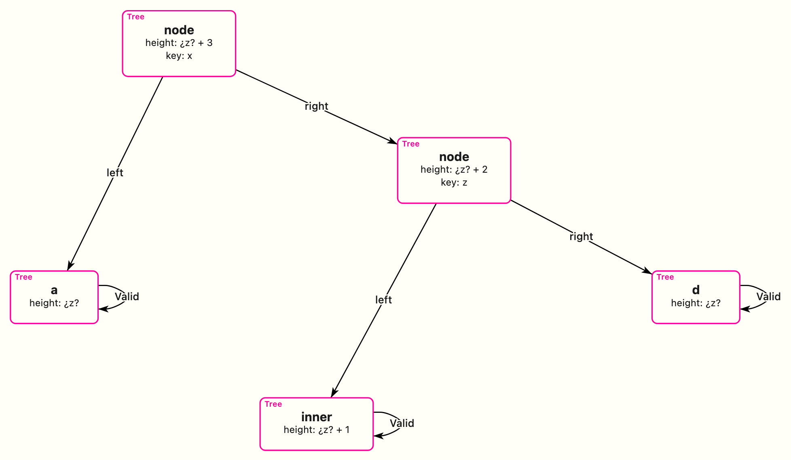
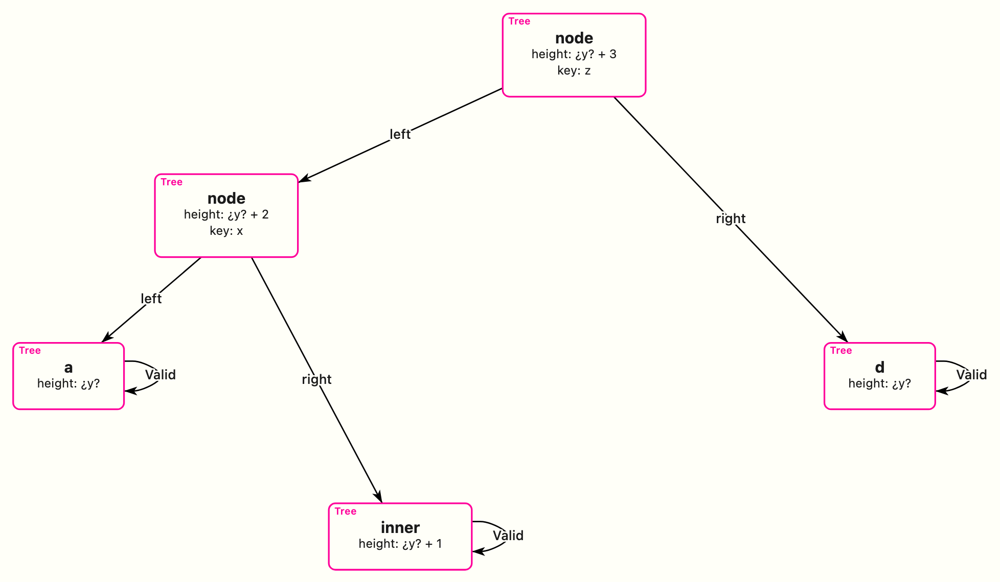
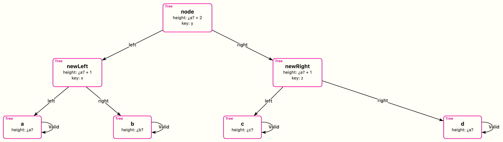

# Can this rotation possibly work?

Try returning `join a x (join inner z d)`. It is a perfectly good binary search tree whenever the input was one. Every key survives. Every key is still in order. Lean closes the key-sequence goal with `simp`. Now the programmer owes a proof of

```lean
⊢ Valid (join a x (join inner z d))
```

Should we spend the next ten minutes looking for a lemma, or change the line of code that produced the tree? In one branch of AVL insertion this rotation is the right answer. In the other, the proposition on the screen is false for **every** tree that can reach it.

This is a design experiment in a Lean adaptation of Alexander Gillon’s verified AVL insertion. Gillon makes the correct choice. To see what it takes to *discover* that choice, we will put the single rotation from one branch on trial in the other. The complete map and proofs are also available in the mathlib example. [Runnable experiment](GillonAVL.lean#L91) · [Full Lean development](../examples/mathlib/gillon/README.md) · [Gillon’s implementation, Appendix A](https://www.andrew.cmu.edu/user/avigad/Students/gillon_landc_thesis.pdf#page=20)

## What the programmer has to do without inspection

Insertion has returned from the left child of a node with key `z`. Both children are valid AVL trees, but the new left child is two levels taller than the right child `d`. Opening the left child exposes its key `x` and two subtrees `a` and `inner`. In the branch we are writing, `inner` is taller. The proof has already established two height equalities.

```lean
outerLevel : height a = height d
innerLevel : height inner = height d + 1
```

Try to spot the bug from those two lines. They describe the **input**. The goal describes the **proposed output**. To bring them together, we must unpack `Valid`, recover which subtree each argument of each `join` denotes, unfold `height` on the new right child, and decide which side of a `max` wins. Only then do we discover that the goal requires `h + 2 ≤ h + 1`, where `h = height d`. Anyone who knows AVL trees can do this on paper. The question is why the person at the keyboard should have to draw that picture from scratch every time they change a rotation.

A concrete test is another good way to catch this mistake. It costs us something specific here. To run the test, we must choose the keys, invent the subtrees, and give them particular heights. The branch already describes a whole family of inputs for which the rotation fails. Can we inspect *that family* while it is still the subject of the proof?

## Inspect the tree we are tempted to return

```lean
spytial (join a x (join inner z d)) observing [height] with [.., attribute height]
```



*Figure 1. A single right rotation under the inner-heavy branch assumptions. The infoview calls the unknown height of `d` `¿z?`.*

Read the two edges out of `x`. On the left is `a`, height *h*. On the right is the node with key `z`, height *h* + 2. **We have moved the imbalance.** Follow the right edge one step farther and we can see why. We tucked `inner`, already of height *h* + 1, under `z`. No amount of work on the cache proof, the key ordering, or the validity of `a` can make this candidate balance. The companion Lean theorem proves that the rotation preserves the entire in-order sequence and that its result violates `Valid`.

The interesting number in Figure 1 is the height of the new node at `z`. Neither hypothesis mentions that node. And although the implementation caches heights, the `height` we asked for is an ordinary recursive Lean function. Spytial applies it to the terms in the inspection. For `join inner z d`, it obtains `max (height inner) (height d) + 1`. Spytial prepares the branch’s local proofs with Lean and Aesop, then asks Lean’s arithmetic automation to prove the comparison needed to simplify the maximum. The result is a checked equality identifying the height of the *new expression* with *h* + 2. One unknown number suffices for the diagram. Choosing a value for it would add nothing to the diagnosis.

## Which subtree should we open?

Return to the input in Figure 2. The node at `x` has two children whose interiors are unknown. We could split on either one in Lean. Every such split introduces constructor cases and another collection of fields and hypotheses. Which split earns its keep?



*Figure 2. The inspection in Gillon’s inner-heavy branch. Here the infoview calls the unknown height of `d` `¿y?`. Both outer subtrees carry it.*

Look at `inner`. It sits to the right of `x` and to the left of `z`. A key taken from there can go above both of them and preserve their order. Its height, *h* + 1, guarantees there is a key to take. That is a prediction we can make **before** choosing a constructor for `inner`. Gillon’s next proof obligation is exactly that `inner` cannot be a leaf. Matching on it gives a key `y` and two subtrees `b` and `c`; the code can leave `a` and `d` alone.

Two facts in the picture have different origins. The validity hypothesis on the old left child supplies proofs of `Valid a` and `Valid inner`, drawn as loops on the corresponding boxes. Spytial’s specification on `Tree` puts the whole left subtree to the left and aligns trees whose heights are provably equal. Here `a` is a grandchild of `z` and `d` is a child. The rule puts them on the same row because the proof relates their heights. [Inspect the input](GillonAVL.lean#L94)

## When can we stop opening the tree?

```lean
let newLeft := join a x b
let newRight := join c z d
let rebuilt : Tree := spytial (join newLeft y newRight) observing [height] with [.., attribute height]
```



*Figure 3. The actual return expression. The two new children have observed height* h + 1. *The exact heights of* b *and* c *are still unknown.*

Look at the two pairs in Figure 3. The left child pairs `a`, whose height is exactly *h*, with `b`, whose height is at most *h*. The right child pairs `d`, also of height *h*, with `c`, also bounded by *h*. Each pair therefore has maximum *h*. We can read off the two intermediate lemmas we need. They are `height newLeft = height d + 1` and `height newRight = height d + 1`. The observation already reports both results on the `let rebuilt` line, before either lemma appears in the proof. Splitting on both `b` and `c` would buy us four constructor combinations and no stronger conclusion about the root. [Inspect the expression](GillonAVL.lean#L110) · [See the lemmas that finish the proof](GillonAVL.lean#L114)

## Where this sits in Gillon’s development

Gillon implements a finite map. Lookup follows a comparison at each node. Insertion at an equal key overwrites its value. A smaller or larger key sends insertion down the corresponding child. On the way back up, the caller must decide whether to rebuild the parent or rebalance it. On a left overflow, a taller inner child calls for the double rotation above; otherwise a single right rotation suffices. A right overflow exchanges left and right. The decision is about *where the extra level came from*. Knowing only that the root is out of balance leaves both repairs on the table.

His proof carries considerably more than balance. The rebuilt node needs the correct cached height; each key must stay on its proper side of its ancestors; the inserted key must still map to its value. The last fact connects the local repair to the public theorem that looking up the inserted key returns the inserted value. Gillon also proves that lookup in the empty map returns nothing. The thesis separately states preservation of lookup at *other* keys and explicitly leaves that theorem open. [Map interface and theorem status, §2.3](https://www.andrew.cmu.edu/user/avigad/Students/gillon_landc_thesis.pdf#page=4)

Those obligations explain why it matters to locate the failure. The single rotation passes the key-order check. It even reconstructs the nodes with fresh cached heights. In this branch it will *never* pass the balance check. The diagram lets us eliminate that entire proof attempt while every key is still a variable, then tells us which one of the unopened subtrees can supply the repair.
